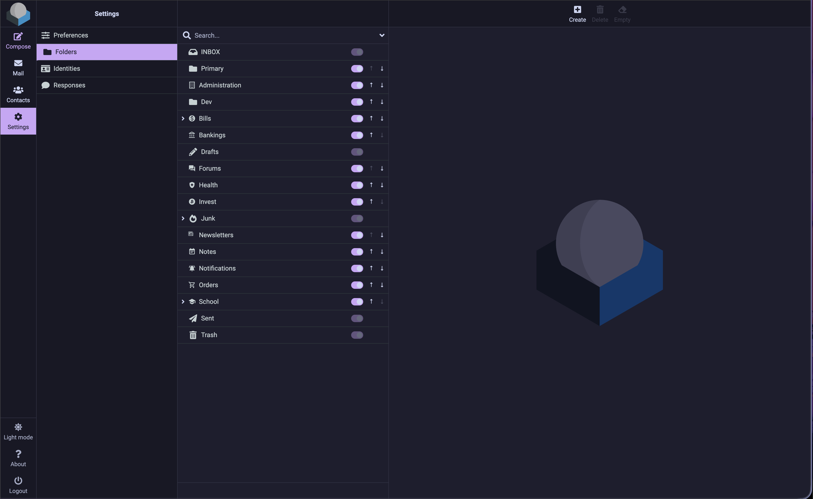

# Roundcube Folder Order

Manual folder ordering in the Roundcube Elastic sidebar — drag-free ↑/↓ arrows in Settings → Folders, sorted server-side, stored per user.

[](LICENSE)

## Requirements

- Roundcube **1.6+** with the **Elastic** skin
- PHP **8.1+**

## Installation

### Composer (recommended)

```bash
cd /path/to/roundcube
composer require armanoide/roundcube_folder_order
```

<sub>Pending first Packagist publication — until then, use the manual install below.</sub>

### Manual

```bash
git clone https://github.com/Armanoide/roundcube_folder_order.git \
    /path/to/roundcube/plugins/roundcube_folder_order
```

Then enable it in `config/config.inc.php`:

```php
$config['plugins'][] = 'roundcube_folder_order';
```

### Docker

```yaml
services:
  roundcubemail:
    image: roundcube/roundcubemail:latest
    volumes:
      - ./plugins/roundcube_folder_order:/var/www/html/plugins/roundcube_folder_order
```

## Usage

**Reorder folders** — Settings → *Folders* → click the ↑/↓ arrows on any row. The order saves immediately — no form, no Save button. Folders missing from your saved order (new ones) appear after the ordered ones, alphabetically — nothing ever disappears.



## License

[MIT](LICENSE) © 2026 Armanoide
